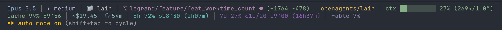

# claude-statusline



Claude Code 两行状态栏（Bash + jq）。

- 第 1 行：模型、思考程度、目录、Git 分支/改动、ctx 用量
- 第 2 行：Cache 命中率与 TTL、费用、耗时、5h / 7d / Fable 限额
- `statusline-fable-refresh.sh`：缓存过期时在后台请求 OAuth Usage API 刷新 Fable 周额度；令牌取自本机钥匙串，只在内存中使用，缓存仅保存百分比

## 同步

```bash
git clone <本仓库> && cd claude-statusline && ./install.sh
```

`install.sh` 只修改 `~/.claude/settings.json` 的 `statusLine` 字段。仓库不包含任何凭据。

## 反向同步（本机改了脚本后）

```bash
./sync.sh "说明"   # 复制 ~/.claude 下的脚本，有变化则提交并推送
```
